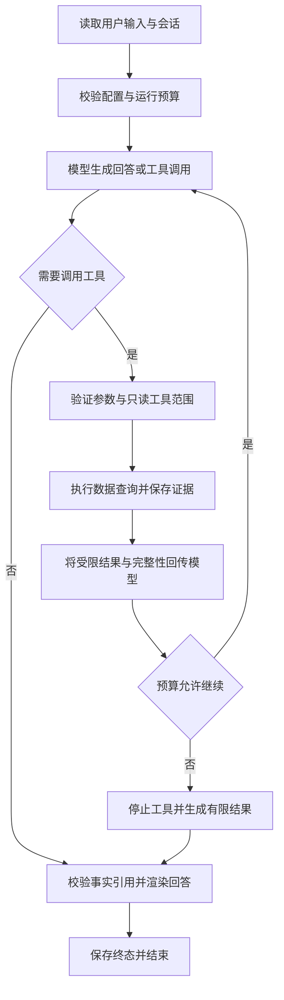

# LedgerScout Agent Runtime 架构与选型说明

日期：2026 年 11 月 11 日。版本：0.1。状态：用户已确认的设计。首版实现与验证见[集成记录](../../runtime-integration.md)；下文保留实施前的方案和约束。

## 1 设计结论

首版保留 Node.js 与 TypeScript，优先采用 Pi Agent Core 作为工具调用循环的执行内核。LedgerScout 在内核外实现查询工具、运行限制、会话记录和证据格式化，并通过内部接口隔离 Pi 的消息类型与事件。AstrBot 是运行控制和模块划分的主要参考，LangGraph.js 是状态持久化和将来复杂流程的对照方案。

本稿将上述路线作为推荐设计。Pi 的发布版本兼容性验证是实现阶段的第一项工作；当前尚未安装 Runtime 依赖、选定模型供应商或验证真实模型调用。不能把分支源码中存在的接口等同于某个已发布版本可用。

首版交付目标是：用户在命令行输入公开 Ethereum 地址和问题，助手调用已验证的数据服务，给出可追溯的查询结果，并准确显示失败、部分历史和未完成事项。

## 2 已有基础与改造范围

当前 `data-validation/` 已有配置、只读 API、HTTP 传输、分页归一化、脱敏和结果落盘模块。2026 年 11 月 11 日的真实测试已验证主网连通性、ETH 余额、普通交易与双向转账；普通交易和转账达到上限时为部分历史，固定小区块窗口的真实空结果也通过检查。依据为根目录的产品需求文档与 [接口测试记录](../../../接口测试记录_2026-11-11.json)。

当前代码仍是验证程序，直接接到 Agent 上有四个缺口：

1. `Checks` 从构造配置读取目标地址和范围，需要改成每次查询独立的输入，不能修改进程环境变量处理用户请求。
2. `Transport` 仅有单请求超时，没有接收上层取消信号；运行取消后需要同时中止请求、退避等待和分页。
3. 请求间隔属于单个 `Transport` 实例；新建多个实例不能保证同一供应商的全局串行间隔。
4. 当前摘要落盘不等于可供模型引用的证据协议，需要建立查询 ID、证据 ID、来源和完整性字段。

改造时提取公共服务，让原验证 CLI 与 Agent 使用同一套实现，保留原有四项检查和离线测试作为回归入口。

## 3 开源源码参考

以下为 2026 年 11 月 11 日实际阅读的默认分支源码。链接指向分支，后续可能变化；实现时将选中的发布版本和对应提交写入依赖锁文件及集成记录。此处区分上游已有机制与 LedgerScout 的设计选择。

| 参考模块 | 源码中可见的机制 | LedgerScout 的采用方式 |
| --- | --- | --- |
| [AstrBot Runner](https://github.com/AstrBotDevs/AstrBot/blob/master/astrbot/core/agent/runners/tool_loop_agent_runner.py) 与 [Runner 基类](https://github.com/AstrBotDevs/AstrBot/blob/master/astrbot/core/agent/runners/base.py) | 单步执行、最大步数、重复工具调用提示、工具执行事件及结束状态处理 | 借鉴显式状态和统一收尾；本项目额外硬性限制重复查询，不能只依赖提示词劝模型停止 |
| [AstrBot 工具定义](https://github.com/AstrBotDevs/AstrBot/blob/master/astrbot/core/agent/tool.py) | JSON Schema、工具集合、每工具超时、多种模型格式转换 | 工具注册与参数验证独立于供应商；只注册本项目允许的只读查询 |
| [AstrBot 上下文管理](https://github.com/AstrBotDevs/AstrBot/blob/master/astrbot/core/agent/context/manager.py) | 按轮次截断、Token 计数与压缩，保留工具调用和结果的配对 | 首版按完整轮次控制上下文；保留结构化证据索引，长列表留在本地，不要求模型总结原始完整账本 |
| [Pi Agent Core 文档](https://github.com/earendil-works/pi/blob/main/packages/agent/README.md)、[循环](https://github.com/earendil-works/pi/blob/main/packages/agent/src/agent-loop.ts)、[类型](https://github.com/earendil-works/pi/blob/main/packages/agent/src/types.ts) | TypeScript Agent、事件流、上下文转换、执行前后钩子、取消信号、可选串并行执行 | 首选执行内核；通过适配器实现 LedgerScout 的运行预算、证据协议和最终状态，工具首版串行执行 |
| [LangGraph.js ToolNode](https://github.com/langchain-ai/langgraphjs/blob/main/libs/langgraph-core/src/prebuilt/tool_node.ts) 与 [检查点](https://github.com/langchain-ai/langgraphjs/blob/main/libs/checkpoint/README.md) | 按工具调用 ID 返回结果、区分工具错误与控制流中断、按会话保存状态及待完成写入 | 借鉴关联 ID 和持久化边界；首版记录可检查历史，不承诺中途自动恢复执行 |

上述结论来自源码阅读，不代表已经在 LedgerScout 中运行这些框架。首版对上游的使用以包依赖和独立适配为主，不复制 AstrBot 的 Python 实现。

## 4 方案比较与选择

| 方案 | 当前项目的收益 | 代价与适用阶段 | 本稿判断 |
| --- | --- | --- | --- |
| Pi Agent Core 加领域适配层 | 沿用 TypeScript，可复用工具循环、事件和模型接口，业务代码边界清楚 | 需要自行补齐硬性预算、证据、会话存储和取消传递，并验证发布版钩子 | 首版推荐 |
| LangGraph.js 状态图 | 显式状态、检查点和中断恢复适合多阶段研究 | 三类查询暂不需要完整图编排；引入更多状态和依赖概念 | 出现持久化复杂流程需求时重新评估 |
| 基于 AstrBot 构建插件或部署其服务 | 适合需要其消息平台、插件管理和现成界面的产品 | 当前数据层是 TypeScript，需要新增 Python 服务或跨进程边界 | 当产品明确选择 AstrBot 作为宿主时采用 |

完全手写通用模型与工具循环会增加协议处理和异常路径的维护范围，本轮不作为首选。首版通过兼容性验证后锁定 Pi 的精确版本；若所选发布版缺少必要的取消、工具校验或结束控制能力，先记录差异并更新选型，再进入产品实现，不临时隐式更换内核。

## 5 首版范围

首版提供单用户本地命令行、多轮会话、单个 Agent，以及 Ethereum Mainnet 的余额、普通交易和双向 ETH/ERC20 转账查询。一次运行按固定地址和明确区块范围读取数据，支持查看本地证据的有限分页。

模型供应商尚未选定。本稿定义模型适配边界，保留配置空间；真实模型测试必须先由用户选定供应商、模型及凭据来源。架构文档和离线模拟无需模型密钥。

股票适配、跨资产计算、ENS 解析、自然语言日期到区块转换、后台任务、联网搜索和自动续跑不属于首版。用户问“最近七天”时，首版应说明当前接受区块窗口并请求补充，不能将最近 50 条记录称为最近七天。用户提供合法地址后查询，不把验证脚本的默认公开地址静默当作用户目标。

## 6 模块边界与建议目录

实现时采用 npm workspaces 管理共享包，既有 `data-validation/` 保留原来的运行位置。下面是建议结构，目录中的新增模块均尚未创建：

```text
LedgerScout/
  .env                         本地供应商凭据
  package.json                 私有 workspace 根配置
  data-validation/             保留现有验证命令，改为调用公共数据包
  packages/
    chain-data/
      src/config.ts            数据供应商配置与输入校验
      src/transport.ts         超时、共享调度、有限重试、取消
      src/queries.ts           参数化余额、交易、转账服务
      src/normalize.ts         精确金额与归一化
      src/evidence.ts          原始响应、查询摘要、证据索引
    agent-runtime/
      src/engine/pi.ts         Pi 消息与事件的唯一适配入口
      src/runtime.ts           运行生命周期、预算与终态
      src/tools.ts             工具注册、Schema 与授权范围
      src/model.ts             模型配置和供应商适配
      src/session.ts           会话与运行记录
      src/context.ts           上下文选择和容量控制
      src/answer.ts            事实模板、证据校验和答案渲染
      src/cli.ts               命令行与取消处理
  runtime-results/             本地会话和运行证据，加入忽略规则
  docs/superpowers/specs/       架构说明
```

`chain-data` 不导入模型 SDK 或 Pi 类型。`agent-runtime` 的业务工具只依赖项目自己的查询协议，Pi 特有类型集中在 `engine/pi.ts`。数据服务作为 workspace 包导出，避免跨目录直接导入验证项目的内部 `.ts` 文件。

公共数据包提取现有 `api.ts`、`http.ts`、`checks.ts` 与 `output.ts` 的能力；原 CLI 成为调用公共服务的验证入口。具体构建配置和包内文件拆分由实现者确定，但不得复制出两套分页、重试或金额算法。

## 7 查询工具协议

| 工具 | 模型可填写的参数 | 返回内容 |
| --- | --- | --- |
| `get_eth_balance` | 完整 `address`，可选整数 `blockNumber` | 固定区块、精确 wei 和 ETH 字符串、查询及证据 ID |
| `list_normal_transactions` | `address`、`startBlock`、可选 `endBlock`、`pageSize`、`maxPages`、`maxRecords` | 普通交易摘要、失败交易标记、完整性、有限预览及证据 ID |
| `list_asset_transfers` | 与交易查询相同的范围及上限参数 | 流入、流出独立分页的计数、类别、原始金额、精度、Token 合约和完整性 |
| `read_query_evidence` | 本会话的 `queryId`、允许的集合名、整数 `offset` 与 `limit` | 已取得的归一化记录片段，不发起上游请求 |

网络固定为 Ethereum Mainnet。区块必须为安全的非负整数，起点不得超过终点，地址必须为 20 字节 0x 字符串。未知参数、未知工具、非法地址和越界范围均在请求前拒绝，不由模型自行决定 RPC 方法或上游 URL。

历史查询默认每页 25 条、最多 2 页、最多保留 50 条；Runtime 首版硬上限为每页 100 条、每方向最多 4 页、每方向最多 200 条，并同时受总请求预算约束。原验证 CLI 可继续保留原参数范围。读取本地证据每次最多 20 条。

未显式传历史终点时，在本次运行中先校验主网并取得一个快照区块；同次运行内需要比较的查询复用该终点。余额默认也使用该快照，可显式查询不晚于快照的历史区块，但能否返回取决于供应商权限。原验证 CLI 的逐项快照行为继续保留。固定高度并不消除链重组和索引延迟。

每个查询创建不可变参数对象，不写入 `process.env` 或修改其他查询的配置。一次运行所有工具串行执行，底层再按供应商共享调度器限制请求间隔；限流间隔覆盖重试和分页，不能因为查询创建了新实例而重置。首版只支持一个本地进程，多进程间的账户级配额协调暂不承诺。

### 7.1 返回包与证据

所有查询使用统一包，至少包含 `schemaVersion`、`queryId`、`network`、`address`、`range`、`fetchedAt`、`status`、`data`、`completeness`、`evidenceRefs` 和 `warnings`。`range` 保存实际采用的区块，不能只保存用户传入的空终点。

查询状态为 `ok`、`partial` 或 `error`。达到条数或页数上限属于 `partial`，不是全历史完成。双向转账分别保存完整性和停止原因。若后续分页失败，保留已取得记录，返回 `partial` 和结构化错误，注明这些记录未覆盖目标窗口；一条记录也未取得时返回 `error`。原始响应保留每次尝试的真实状态。

`evidenceRefs` 关联本地证据 ID、供应商、调用方法、取得时间和可用的交易链接。证据 ID 映射到运行目录内的文件；模型看到 ID 与受限预览，不接收任意磁盘路径、请求头或包含密钥的 URL。`read_query_evidence` 仅能访问当前会话登记的查询，不能用路径穿越或其他会话 ID 读取数据。

金额保留原始整数字符串和精度，不把浮点 `value` 用于精确计算。首版不把所有 Token 相加为单一金额，不计算收益或将资金流当作利润。普通交易与转账是不同类别，不能相加声称“总交易次数”。

## 8 执行过程与状态



建立 `sessionId`、`runId`、`modelRequestId`、`toolCallId`、`queryId` 五类关联 ID。工具结果必须与原工具调用 ID 一一对应，工具错误不能伪装为成功文本。异常和取消走统一收尾路径，每个运行恰好写入一个终态事件。

运行先经过 `created`、`running`，然后进入以下一种终态：

| 终态 | 条件 |
| --- | --- |
| `completed` | 已回答当前问题，所依赖查询在其声明范围内完成 |
| `partial` | 已有可用结果，但依赖查询不完整或部分失败 |
| `awaiting_user` | 缺少地址、区块范围或需要用户选择，当前轮结束等待输入 |
| `failed` | 没有足够结果完成请求，或发生无法收尾的内部错误 |
| `cancelled` | 用户取消，停止新增调用并中止在途工作 |
| `exhausted` | 步数、调用数、请求数或运行时长预算耗尽 |

运行终态按取消、资源耗尽、无法回答的错误、待补充输入、部分结果、正常完成依次判定。工具层 `partial` 与运行层 `exhausted` 分别描述数据覆盖和执行结束原因，二者均写入结果，不互相覆盖。并非所有诊断工具的失败都使回答失败：若已满足用户问题，保留警告并按实际依赖结果判定。

### 8.1 默认运行限制

以下为本稿提出的首版默认值，不是已经测得的性能指标。

| 限制 | 默认值与计数口径 |
| --- | --- |
| 模型请求 | 每次运行最多 8 次，包含重试和最终总结请求 |
| 工具调用 | 最多 12 次，包含证据读取和被拒绝的调用 |
| 上游 HTTP 请求 | 最多 32 次，每次网络尝试、重试和分页分别计数 |
| 单次模型等待 | 30 秒，受运行总时长约束 |
| 单次工具执行 | 45 秒，覆盖所有分页、等待和重试 |
| 运行总时长 | 120 秒，使用单调时钟计时 |
| 模型上下文 | 根据选定模型能力配置，初始目标不超过约 12000 Token；实际输出另设上限 |

第 8 次模型请求只允许收尾，不再提供工具。若模型不可用、没有剩余时间或结构化回答校验仍失败，由确定性模板输出已有事实、失败原因和待完成事项。达到限制必须在执行前阻止下一项操作，不能执行完才发现超额。

相同工具和归一化参数，在同一运行、同一区块快照内成功执行后复用已有结果；确需扩大范围时必须有不同参数。对连续相同参数的失败尝试最多允许 2 次，之后拒绝并要求改参数或收尾。工具内部 HTTP 重试只由数据传输层处理，Runtime 不再外包一层工具重试。

模型适配器仅对明确的临时网络错误、限流与 5xx 最多重试 1 次，间隔上限 2 秒，且计入模型总请求预算；认证、参数、格式和额度耗尽不自动重试。Token 使用量记录供应商报告值，缺失时标记未知；估算值用于容量控制，不宣称能精确保证费用上限。

### 8.2 取消与错误

顶层创建运行 `AbortController`，将信号传递给 Pi、工具、分页循环、HTTP 请求、调度等待、退避等待和证据写入前检查。HTTP 层组合运行信号与单请求超时信号，区分用户取消、工具超时和网络错误。取消不重试；已接收响应的脱敏保存及最终状态写入使用独立的短收尾期限。

工具错误使用机器可读代码，如 `INVALID_ARGUMENT`、`AUTH_ERROR`、`RATE_LIMIT`、`QUOTA_EXHAUSTED`、`NETWORK_ERROR`、`TIMEOUT`、`PROVIDER_RESPONSE_INVALID`、`EVIDENCE_WRITE_FAILED`。错误回传必须经过脱敏。关键证据写入失败时，不得报告一项具有可追溯证据的成功查询。

## 9 上下文与会话记录

每个会话保存用户和助手消息、工具调用关联、已选地址、固定范围及证据索引。用户切换地址或范围时建立新查询，避免把旧证据当作新数据。新会话默认从空状态开始；重开既有会话可以加载已完成的历史，但不自动重放尚未完成的上游请求。

建议本地文件结构为 `runtime-results/<sessionId>/<runId>/`，包含 `events.jsonl`、原始响应、归一化查询结果、证据索引、`answer.json` 和 `run-summary.json`。JSONL 采用单写者顺序追加，摘要使用临时文件后原子替换。进程异常退出后，未写终态的运行显示为 `interrupted` 恢复标记；这不表示重新执行或自动续跑。

模型上下文由最近的完整对话轮次、当前目标与范围、必要的工具调用配对和证据摘要组成。裁剪以完整轮次为单位，不能只删除工具结果而保留悬空调用。历史列表先落盘，再给模型受限预览；需要详情时调用证据读取工具。首版不增加额外模型摘要请求作为记忆机制。

输入过大时，先缩减历史和预览；当前轮仍超过配置容量时明确报错或请求缩小问题，不能悄悄丢失当前查询的地址、范围和完整性。Pi 与模型供应商的具体容量参数由兼容性验证后的适配器负责映射。

## 10 回答与只读边界

最终回答固定包含研究对象、网络、实际区块范围、数据取得时间、关键结果、证据和完整性。模型组织解释；精确事实由项目格式化层从查询结果渲染。

建议模型返回带类型的事实引用，如查询 ID、记录 ID 和允许的字段名，不允许模型在事实字段中另填一份余额或交易数量。格式化层核验引用属于本次可用证据后，从原始归一化字段生成数值和交易链接。没有证据的引用拒绝渲染；最多占用一次剩余模型请求修正，仍不合法则使用确定性模板。解释作为单独内容展示，不能改变事实区的数字、完整性或错误状态。

首版事实模板覆盖余额、记录数、交易状态和转账类别。对未实现的收益、价格、因果关系或地址身份推断明确说明能力范围。自由文本解释仍需通过评测发现不支持的陈述，结构化引用不能被描述为对任意自然语言结论的形式化保证。

只读限制在代码边界执行：模型仅能看到注册工具，数据层仅允许 `eth_chainId`、`eth_blockNumber`、`eth_getBalance`、`alchemy_getAssetTransfers` 与固定 Etherscan V2 普通交易查询。首版不提供 Shell、任意 HTTP、钱包签名、交易广播或任意文件读取工具。

密钥只在供应商适配器内读取。不得进入模型消息、工具参数、事件日志、证据索引或错误输出。Token 名称、合约元数据和工具结果中的自然语言作为不可信数据处理，不能据此新增工具或改变查询权限。

## 11 模型和运行配置

模型配置与链上供应商配置分开管理。至少支持模型供应商标识、模型名、单次输出上限、请求超时，以及本地密钥变量名；具体变量名称随首个已选供应商确定，不把 Alchemy 或 Etherscan 的 key 用作模型凭据。

模型适配层把当前供应商的响应转换为内部消息、工具调用、用量和错误；缺少工具调用能力的模型在配置检查时拒绝。凭据未配置时，真实对话请求前失败；离线测试使用可编排的假模型，不生成伪装成真实研究的数据。

运行继续使用根目录 `.env`。代理配置在进程启动阶段生效，不能指望现有不修改 `process.env` 的 `.env` 解析器让 Node 自动使用代理。当前机器的 Etherscan 真实测试依赖本地代理；启动说明应保留 `HTTP_PROXY`、`HTTPS_PROXY` 与 `NODE_USE_ENV_PROXY` 的实际使用方式，禁止关闭 TLS 校验来解决网络问题。

## 12 实现顺序与验收

以下是交付顺序与检查点，后续实现计划再拆为具体文件修改和命令。

| 顺序 | 交付项 | 完成依据 |
| --- | --- | --- |
| 1 | Pi 发布版本兼容性与内部适配接口 | 用假模型验证工具 Schema、工具调用关联、错误回传、事件顺序、取消和收尾控制；记录确切依赖版本 |
| 2 | 公共数据包与验证 CLI 迁移 | 原有 22 项离线测试和类型检查继续通过；原有验证命令仍可运行 |
| 3 | 参数化查询、共享调度与证据协议 | 两个地址输入互不污染；取消能终止在途请求与等待；部分分页失败仍保留真实证据 |
| 4 | Runtime、会话与命令行 | 假模型完成查询和多轮澄清；预算、重复调用检测、终态和本地证据关联可复核 |
| 5 | 真实模型端到端验收 | 已选供应商及本地凭据后，以真实模型调用真实链上工具；回答事实与证据一致 |

必须覆盖以下行为，不能只测试一条成功路径：

- 用户未给地址、地址非法、只给 ENS 或使用未支持的日期窗口时，按定义澄清或拒绝，不静默查询默认地址。
- 查询余额时固定区块，原始 wei 与显示 ETH 保持精确一致。
- 普通交易分页、失败交易、双向转账独立游标和 ETH/ERC20 分类保持原语义。
- 达到上限显示部分历史；真实空结果显示零条；重复页或游标不会误报完整。
- 某页成功后后续页失败，保存已经获得的记录，明确失败与覆盖缺口。
- 模型调用不存在的工具、给出多余参数或无效证据 ID，执行前拒绝并有限收尾。
- 模型反复调用相同工具、达到请求预算、持续输出空内容或无法生成合法最终回答时，有界退出。
- 用户在 HTTP 请求、分页间隔、退避和模型等待中取消，停止新增工作并且只产生一个终态。
- 模型请求失败、无用量字段、Token 预估不足或记录写入失败时，保持真实状态，不把过程结束当作任务完成。
- 工具结果含提示注入、密钥回显或异常字符串时，不扩大工具权限，落盘与回传均脱敏。
- 查询到部分历史时最终答案仍显示限制，无法依赖模型自行记住这一要求。
- 新会话不继承旧地址；重开会话不冒充自动恢复一个中断任务。

离线测试验证 Runtime 行为和数据边界；真实模型与真实数据接口共同验证端到端调用，两者分别记录。现有真实测试只证明数据层可用，不能提前作为 Runtime 已通过的证据。

## 13 后续扩展条件

当股票市场与数据源确定后，新增数据包和只读工具，沿用证据包与错误协议。当研究任务需要持久化的多阶段流程、长任务恢复或人工中断时，再评估 LangGraph.js 或等价能力；已有内部接口应使替换执行内核不影响金额、分页和证据算法。

首版不预建多 Agent、插件市场或长期向量记忆。用户可见的验收重点是能正确取得数据、解释覆盖范围并追溯结果，运行过程遇到错误和限制时仍能可靠结束。
